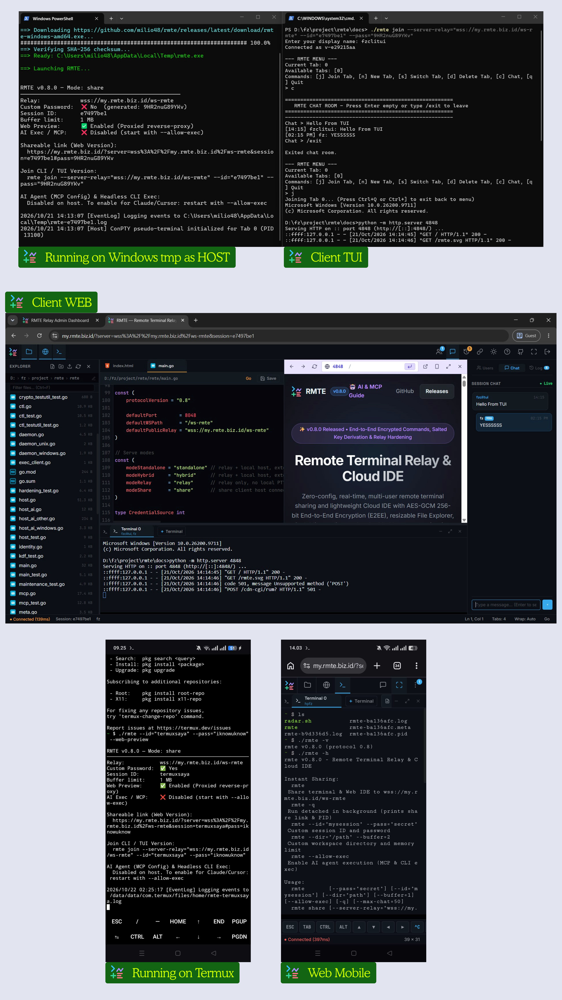
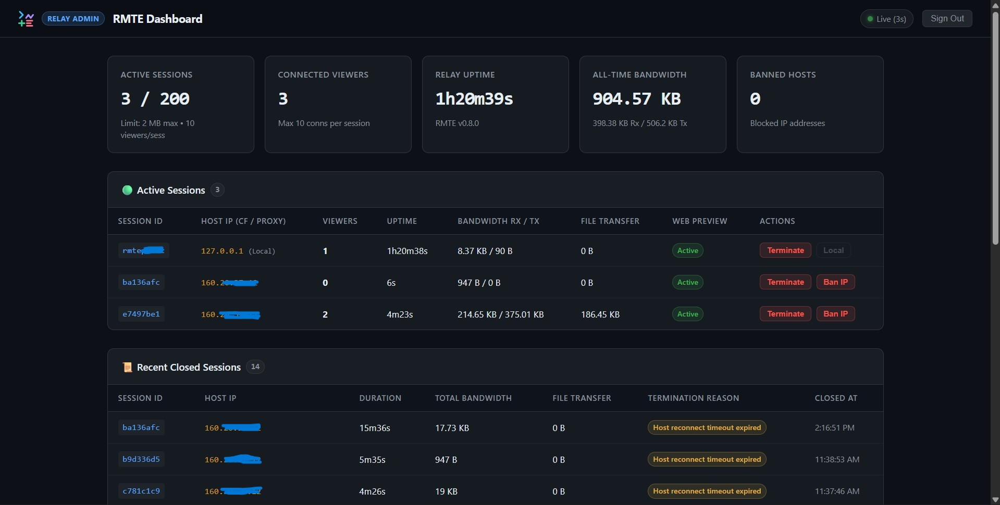

# RMTE — Remote Terminal Relay & Cloud IDE (v0.8.0)

> "I love sshx, but my endless curiosity to build it from scratch got the best of me 🥲"

RMTE is a secure, real-time, multi-user remote terminal sharing system and lightweight Cloud IDE. It is built entirely in Go with a centralized WebSocket relay architecture, securing all traffic with **AES-GCM 256-bit End-to-End Encryption (E2EE)**.

It allows hosts to share terminal sessions, navigate directories using a clean absolute-path File Explorer, edit files in real-time via a multi-tab Web UI, and inspect local web servers via an embedded Mini Browser—all packed into a single binary.

---

## Screenshots & Showcase

| 📱/💻 Workspaces & Mobile UI | 🛡️ Relay Admin Dashboard | 🔑 Secure Login |
| :---: | :---: | :---: |
| <a href="screenshots/overview.jpg" target="_blank"></a> | <a href="screenshots/admin.jpg" target="_blank"></a> | <a href="screenshots/login.jpeg" target="_blank"></a> |
| <sub><i>Overview: Multi-Tab, Split IDE & Mobile</i></sub> | <sub><i>Live Traffic, Bandwidth & Session Monitor</i></sub> | <sub><i>Zero-Knowledge Auth Interface</i></sub> |

> 💡 *Click any image to view in full resolution.*

---

<details>
<summary><h3>✨ Key Features (click to expand)</h3></summary>

* **AI Agent Gateway & Model Context Protocol (MCP) (`🤖`):**
  * Direct zero-dependency **Model Context Protocol (MCP)** integration over stdio (`rmte mcp`) enabling local AI coding agents (Claude Desktop, Cursor, Claude Code, Antigravity) to work directly inside remote locked-down hosts/containers.
  * 7 powerful AI tools built-in: `rmte_exec` (synchronous execution in persistent isolated `[AI]` tab or dedicated background tabs), `rmte_read_file`, `rmte_write_file`, `rmte_upload_file`, `rmte_download_file`, `rmte_list_files`, `rmte_get_info`.
  * **Headless CLI Execution (`rmte exec`)**: Execute remote commands from local shell scripts and receive exact exit codes and clean stdout/stderr over E2EE.
  * **Read-Only Human Spectator Protection**: Live visual feedback of AI commands in the Web IDE without allowing human spectators to disrupt the AI's PTY.
* **Embedded Web Browser Preview (`🌐`):**
  * Built-in mini-browser directly inside the Web IDE tab bar, allowing developers to test local web apps (Vite, Next.js, React, Bun, Python, Dufs, Go, etc.) without leaving RMTE.
  * **Relay-Assisted Reverse Proxy**: Proxies any local port via path `/p/<session>/<port>/` over the single relay port with **zero external DNS dependency** (runs on plain raw IP).
  * **Anti-Lag Transport**: Uses an isolated secondary WebSocket (`{$ws-path}-proxy`) multiplexed with `smux v2` so high-bandwidth downloads never lag the PTY terminal.
  * **Full HMR & WebSocket Hijacking**: Automatically hijacks WebSocket upgrade requests for live Hot Module Reloading.
  * **Interactive Toolbar & Responsive 390px Mobile View**: Smart address bar, navigation controls (`[◀] [▶] [⟳]`), and mobile device inspection frame.
* **Windows Native ConPTY:**
  * Full pseudo-terminal support on Windows 10/11 using ConPTY: command history recall with arrow keys (`↑` / `↓`), horizontal cursor navigation (`←` / `→`), tab completion, and native ANSI color rendering.
* **E2EE Terminal, Files, Commands & Chat (AES-GCM 256-bit):** Terminal I/O, file contents, control messages (file operations, `ai_exec`, chat) are encrypted and authenticated locally; the relay only routes ciphertext and never receives your password. Web Preview traffic and the relay-served browser UI are the remaining places where the relay must be trusted. See the security model limits below and [SECURITY.md](SECURITY.md).
* **Single-Command Setup:** Run `rmte serve` to start a relay and host session in one process. A random password and a shareable link are printed automatically.
* **HTTP Compatible:** Works on plain HTTP (no HTTPS required). A built-in crypto polyfill (asmcrypto.js) handles AES-GCM when `crypto.subtle` is unavailable.
* **Shareable Links & Auto-fill UI:** Running a host session generates a web URL with pre-filled `?server=` and `?session=` parameters. The Web UI parses these and auto-focuses the password input for seamless onboarding.
* **Modern Web Redesign:** A sleek, split-viewport interface using OKLCH atmospheric themes, Space Grotesk/Inter/JetBrains Mono typography, and portable CSS design tokens (`tokens.css`).
* **Split-Workspace Cloud IDE:** Toggle the folder icon `📁` in the browser tab bar to open a split-view workspace:
  * **Left Panel**: Advanced File Explorer with resizable drag handle (persisted across reloads).
  * **Right Panel**: Tabbed text editor powered by **CodeMirror** (syntax highlighting, line numbers, unsaved indicators `●`, direct `Ctrl + S` saving).
  * **Bottom Panel**: Interactive, multi-tab terminal shells (`+ Terminal`).
* **Modern File Explorer & Manager:**
  * **Absolute PWD & Segment Breadcrumbs**: Displays the full host working directory with clickable path segments and a quick edit button (`✏️` or double-click) to type any path directly.
  * **Drag & Drop Upload & One-Click Download**: Drag files from your computer into the Explorer to upload; click the `⬇` icon to download host files locally.
  * **Parent Navigation (`..`)**: An always-visible `..` folder item allows walking backward up the host's directory structure.
  * **Inline Operations (Zero Browser Modals)**: Creating new files (`+📄`) or folders (`+📁`), renaming (`✏️`), and deleting (`🗑`) are performed via inline text inputs and non-intrusive confirmation strips (`[Yes] [No]`).
  * **Toast Notification HUD**: Directory and workspace errors are reported through transient, auto-dismissing inline Toasts.
* **Host Audit Event Log (`rmte-<session_id>.log`):**
  * Every session lifecycle event (host startup, client connects/disconnects, terminal tabs, and file reads/writes/creations/deletions) is securely logged to `rmte-<session_id>.log` on the host machine.
  * Real-time streaming to the UI with a live unread badge and instant `📥 Export` to download the log.
* **Unified Sidebar & Real-Time Chat Bridge:**
  * Dedicated multi-tab sidebar for `👥 Users` presence, `💬 Chat` (live encrypted bridge between Web and CLI clients), and `📜 Activity Log`.
* **Share Session Dialog (`🔗`):** Convenient modal to copy browser links or CLI join commands with one click.
* **Dynamic Max Buffer & Relay Adaptive Clamping:**
  * Set customizable memory limits via CLI (e.g. `--buffer=5` for 5MB limits) to configure both the terminal ring buffer and the maximum allowed file sizes.
  * **Relay Adaptive Clamping (`--max-buffer`)**: Self-hosted and public relays can set a maximum buffer threshold. If a connecting host requests more memory than allowed, the relay adaptively clamps the session without rejecting the host, and enforces transport-level WebSocket frame ceilings (`SetReadLimit`) to prevent DoS.
* **Relay Resource & DoS Protection:**
  * **Session Capacity (`--max-sessions`)**: Limits total concurrent active sessions (default: `100`, `0` = unlimited).
  * **Viewer Concurrency Ceiling (`--max-viewers`)**: Limits total active WebSocket connections per session across all viewer IDs and tabs (default: `50`, `0` = unlimited).
  * **Lean Smux Multiplexing**: Slices proxy stream buffers to 512 KB and session receive pools to 4 MB (~87.5% memory reduction).
* **Zero-copy Binary Data Channel (Tab ID `255`):** Avoids heavy Base64 parsing overhead. Files are sent as pure, encrypted binary frames over a reserved channel.
* **Background / Quiet Mode (`-q` / `--quiet` & `rmte stop`):**
  * Run `rmte serve` or `rmte share` as a detached background daemon. Prints the connection banner, shareable link, and PID to stdout, then immediately returns control to your shell.
  * Stop background sessions cleanly anytime using `rmte stop <session_id | pid>`.
* **State Persistence & Auto-Reconnect:** Connection credentials live safely in `sessionStorage` for immediate recovery upon page refresh.
* **Relay Admin Dashboard (`--admin-pass` & `--admin-path`):**
  * Built-in administrative web dashboard for self-hosted relays (`standalone`, `hybrid`, `relay`).
  * Live monitoring of active sessions, session capacity limits, connected viewers, and cumulative TX / RX network bandwidth.
  * Force-terminate sessions with one click and ban abusive IP addresses in real time.
  * Configurable dashboard route (default: `/admin`) protected against URI collision.

</details>

---

<details>
<summary><h3>🏗️ Architecture & Security Model (click to expand)</h3></summary>

```
┌───────────────┐                  ┌──────────────┐                  ┌───────────────┐
│               │ E2EE control     │              │ E2EE control     │               │
│               │ (sealed JSON)    │              │ (sealed JSON)    │               │
│               ├─────────────────►│              │◄─────────────────┤               │
│   Host Go     │                  │  Relay Go    │                  │  Viewer JS    │
│  Workspace    │ E2EE terminal +  │  (WebSockets)│ E2EE terminal +  │   Browser     │
│               │ file (Tab 255)   │              │ file (Tab 255)   │               │
│               │◄─────────────────┤              ├─────────────────►│               │
└───────────────┘  (Raw Binary)    └──────────────┘  (Raw Binary)    └───────────────┘
```

1. **E2EE Key Derivation**: Keys are derived locally with PBKDF2-HMAC-SHA256 (600,000 iterations) from the password, salted with the session id, then split with HKDF into separate encryption, relay-auth and preview subkeys. The relay only sees the auth subkey, so guessing a password costs a full PBKDF2 run per guess. Nothing is stored on disk or on the relay: the same session id and password always give the same keys, so a host resumes its session after a restart or reboot.
2. **AES-GCM Binary Frames**: Terminal I/O and file contents (Tab 255) are encrypted with AES-GCM and a random 12-byte IV per frame. The frame header (direction, tab id, transfer id) is authenticated as additional data, so the relay cannot redirect, reflect or re-wrap frames.
3. **Sealed Control Envelope**: Every viewer↔host control message (file operations, `ai_exec` and its output, tab management, presence, chat) is sealed with AES-GCM, bound to the session id and direction, and carries a per-sender sequence number plus the host's per-process epoch. The relay sees only a routing id; it cannot read, forge, reorder or replay these messages, including across host restarts.

**Current limits: the relay is still trusted for the following.**

* **Web Preview is not E2EE.** The browser talks HTTP to the relay, which can see preview requests, responses and cookies.
* **The browser UI is served by the relay.** A malicious relay (or anyone on the network when using plain HTTP) can serve JavaScript that captures the password before encryption, and then act as a legitimate viewer. CLI clients (`rmte join`, `exec`, `mcp`) are not affected by this.
* **Replay** of a captured terminal frame on the same tab is still possible (binary frames have no sequence number yet).
* **Metadata**: the relay sees routing ids, message sizes and timing, and can drop messages or spoof its own status notices (host connected/disconnected, viewer left).

With `--allow-exec`, anyone holding the session password can run commands; prefer a relay you run yourself when browsers join.

</details>

---

## 📦 Installation

### 1-Line Quick Install & Launch
Run RMTE instantly without manual setup. The installer detects your OS and architecture automatically:

**Linux & macOS:**
```bash
# 1. Download to current directory (default)
curl -sSf https://rmte.biz.id/install.sh | sh

# 2. Run immediately without saving to current dir (uses /tmp)
curl -sSf https://rmte.biz.id/install.sh | sh -s run

# 3. Install system-wide (~/.local/bin or /usr/local/bin)
curl -sSf https://rmte.biz.id/install.sh | sh -s install

# 4. Download and run in one shot
curl -sSf https://rmte.biz.id/install.sh | sh -s download run

# 5. Run immediately in background daemon (quiet)
curl -sSf https://rmte.biz.id/install.sh | sh -s run -q
```

**Windows (PowerShell):**
```powershell
# 1. Download to current directory (default)
irm https://rmte.biz.id/install.ps1 | iex

# 2. Run immediately from temp folder
& ([scriptblock]::Create((irm https://rmte.biz.id/install.ps1))) run

# 3. Install to ~/.local/bin and add to User PATH
& ([scriptblock]::Create((irm https://rmte.biz.id/install.ps1))) install

# 4. Download and run in one shot
& ([scriptblock]::Create((irm https://rmte.biz.id/install.ps1))) download run

# 5. Run immediately in background daemon (quiet)
& ([scriptblock]::Create((irm https://rmte.biz.id/install.ps1))) run -q
```

### Pre-built Binaries
Get the latest pre-built releases for your operating system directly from the GitHub releases page:
👉 **[RMTE GitHub Releases](https://github.com/milio48/rmte/releases)**

### Build from Source
Got Go installed (v1.21+)? Let's build the binary:
```bash
git clone https://github.com/milio48/rmte.git
cd rmte/rmte
go build -ldflags "-s -w" -o rmte
```

<details>
<summary><h3>🛠️ Development & Testing Guide (click to expand)</h3></summary>

RMTE is designed with zero frontend dependencies. All web assets in `rmte/ui/` (`tokens.css`, `app.css`, `app.js`, `index.html`) are embedded directly into the Go binary at compile time via `//go:embed ui/*` without requiring Node.js, npm, or bundlers.

1. **Run locally without building:**
   ```bash
   cd rmte/rmte
   go run . serve --dir="../"
   ```
2. **Run Unit Tests:**
   ```bash
   cd rmte/rmte
   go test -v ./...
   ```
3. **Build Binary with Custom Version (`-ldflags`):**
   ```bash
   cd rmte/rmte
   go build -ldflags "-s -w -X main.appVersion=0.7.6" -o rmte
   ```

</details>

---

## 🧭 Terminology

| Term | Meaning | How |
| :--- | :--- | :--- |
| **Relay** | The machine that **opens a port** (HTTP Web UI + WebSocket routing) | `rmte serve` |
| **Host** | The **controlled machine** (shell + files) | `rmte serve` (standalone/hybrid) or `rmte share` |
| **Client** | Whoever controls the host: **Web** browser or **CLI/TUI** | Shareable link or `rmte join` |

## ⚖️ Commands & Modes

| Feature / Role | `serve --mode=standalone` *(default)* | `serve --mode=hybrid` | `serve --mode=relay` | `rmte share` / `rmte` | `rmte join` | `rmte exec` | `rmte mcp` |
| :--- | :---: | :---: | :---: | :---: | :---: | :---: | :---: |
| **Role Summary** | Relay + Local Host | Relay + Local Host | Dedicated Relay Only | Outbound Host | Client (TUI) | Client (Headless Exec) | Client (AI MCP Server) |
| **Opens Listening Port** | ✅ Yes (8048) | ✅ Yes (8048) | ✅ Yes (8048) | ❌ No (Outbound) | ❌ No | ❌ No | ❌ No |
| **Local PTY & Files (Host)** | ✅ Yes | ✅ Yes | ❌ No | ✅ Yes | ❌ No | ❌ No | ❌ No |
| **Accepts External Hosts** | ❌ No (Rejected) | ✅ Yes | ✅ Yes | — | — | — | — |
| **Prints Session ID & Links** | ✅ Yes | ✅ Yes | ❌ No | ✅ Yes | — | — | — |
| **Key Flags** *(full list in Flag Reference)* | `--pass`, `--id`, `--dir`, `--allow-exec` | `--public`, `--pass`, `--id`, `--allow-exec` | `--public`, `--admin-pass`, `--max-buffer` | `--server-relay`, `--pass`, `--id`, `--allow-exec` | `--server-relay`, `--id`, `--pass` | `--server-relay`, `--id`, `--pass`, `--timeout` | `--server-relay`, `--id`, `--pass` |

---

## 🚀 Quick Start Guide

### 0. Instant E2EE Share (Zero-Configuration)
Run `rmte` directly without subcommands to instantly connect to the public relay `my.rmte.biz.id` with Web Preview enabled:
```bash
./rmte
```
Or run detached in the background:
```bash
./rmte -q
```
Or with custom credentials:
```bash
./rmte --id="mysession" --pass="supersecret" -q
```

### 1. Quick local session (Self-hosted standalone)
```bash
./rmte serve
```
Output:
```
RMTE v0.8.0 — Mode: standalone
────────────────────────────────────────────────
Bind:             127.0.0.1:8048
Rmte Port:        8048
Open to Relay:    ❌ No
Directory:        /workspace
Custom Password:  ❌ No  (generated: YJNhJkzGHEhc)
Session ID:       16fd7ce2
Buffer limit:     1 MB
Web Path:         /
WS Path:          /ws-rmte

Shareable link (Web Version):
  http://localhost:8048/?server=ws%3A%2F%2Flocalhost%3A8048%2Fws-rmte&session=16fd7ce2

Join CLI / TUI Version:
  rmte join --server-relay="ws://localhost:8048/ws-rmte" --id="16fd7ce2" --pass="YJNhJkzGHEhc"
```

### Case 1: Single VPS (self-contained)
One machine is both the relay and the host. External hosts are rejected.
```bash
./rmte serve --public --public-url="https://rmte.example.com" --pass="supersecret123"
```
```
┌────────────────────────────────────────────────────────┐
│ VPS_1: RELAY + HOST (rmte serve --public)              │
│ ✓ HTTP port 8048 (Web UI)                              │
│ ✓ WebSocket /ws-rmte (routing)                         │
│ ✓ Local shell & files                                  │
│ ✗ External hosts rejected (standalone)                 │
└───────────────────────────┬────────────────────────────┘
              ┌─────────────┼──────────────┐
           ┌──▼──┐       ┌──▼──┐       ┌───▼────┐
           │ CLI │       │ WEB │       │ WEB    │
           └─────┘       └─────┘       └────────┘
            join         browser        browser
```

### Case 2: Multi-VPS (central relay + separate hosts)
Only the relay opens a port. Hosts connect **outbound**, so they need no open ports.
```bash
# VPS_1 (relay only)
./rmte serve --mode=relay --public --public-url="https://relay.example.com"

# VPS_2, VPS_3, VPS_4 (each becomes a host with its own Session ID)
./rmte share --server-relay="ws://relay.example.com:8048/ws-rmte" --pass="supersecret123" --buffer=5
```
```
┌───────────────┐   ┌───────────────┐   ┌───────────────┐
│ VPS_2: HOST   │   │ VPS_3: HOST   │   │ VPS_4: HOST   │
│ (rmte share)  │   │ (rmte share)  │   │ (rmte share)  │
│ ✗ no open port│   │ ✗ no open port│   │ ✗ no open port│
└───────┬───────┘   └───────┬───────┘   └───────┬───────┘
        │ outbound WS       │                   │
        └───────────────────┼───────────────────┘
                            ▼
┌────────────────────────────────────────────────────────┐
│ VPS_1: RELAY (rmte serve --mode=relay --public)        │
│ ✓ HTTP port 8048 (Web UI)                              │
│ ✓ WebSocket /ws-rmte (routing)                         │
└───────────────────────────┬────────────────────────────┘
              ┌─────────────┼──────────────┐
           ┌──▼──┐       ┌──▼──┐       ┌───▼────┐
           │ CLI │       │ WEB │       │ WEB    │
           └─────┘       └─────┘       └────────┘
            join         browser        browser
```
> Want the relay machine to also be a host? Use `--mode=hybrid` instead of `--mode=relay`.

### Join via CLI Client (TUI)
```bash
./rmte join --server-relay="ws://relay.example.com:8048/ws-rmte" --id="a1b2c3d4" --pass="supersecret123"
```
You'll enter an interactive TUI menu:
* `[j]` **Join Tab:** Dive into the active terminal shell (Press `Ctrl + ]` to escape).
* `[n]` **New Tab:** Spawn a concurrent shell on the host.
* `[s]` **Switch Tab:** Hop between active terminal tabs.
* `[c]` **Chat:** Enter the real-time chat room.
* `[q]` **Quit:** Disconnect gracefully.

### Join via Web Client
Open the shareable link printed by `serve`/`share` (or browse to the relay's web path — the server URL is auto-filled).
1. Enter the E2EE **Password** and click **Establish Connection**.
2. Toggle the folder icon `📁` in the tab bar to access the workspace editor.
3. Double-click the breadcrumb to input any absolute path directly.

### 🤖 AI Agent Integration (MCP & Headless CLI Exec)
You can connect local AI coding agents (Claude Desktop, Cursor, Claude Code, Antigravity) to execute commands, read/write files, and transfer data inside remote host environments over secure E2EE with zero open inbound ports! **Fully supported on Linux, macOS, and Windows hosts.**

#### 1. Enable on Remote Host:
Start the host session with `--allow-exec`:
```bash
./rmte share --allow-exec
# or for self-hosted standalone:
./rmte serve --allow-exec
```
> **Platform Execution Details:**
> - **Linux & macOS Hosts**: Commands execute inside an isolated interactive PTY shell in tab `[AI]`.
> - **Windows Hosts**: Commands execute via headless process pipes (`pwsh.exe` $\rightarrow$ `powershell.exe` $\rightarrow$ `cmd.exe`) with full UTF-8 output encoding support and automatic process-tree cleanup on timeout. Live command outputs stream in real-time to the web viewer's `[AI]` spectator canvas without console prompt noise.
> - **Non-Interactive Stdin**: Executed commands run non-interactively (stdin is non-interactive; commands requiring input should accept CLI flags or environment variables).

#### 2. Headless CLI Execution (`rmte exec`):
Run remote commands from local shell scripts and propagate exit codes:
```bash
# Execute command and return remote exit code:
./rmte exec --id="session_id" --pass="secret" -- "uname -a"

# Windows host example:
./rmte exec --id="session_id" --pass="secret" -- "dir"

# Launch long-running commands in a dedicated background tab:
./rmte exec --id="session_id" --pass="secret" --bg --tab-name="DevServer" -- "npm run dev"
```

#### 3. Model Context Protocol (MCP) Setup:
Configure your local AI coding assistant to communicate with RMTE via stdio:

**Claude Desktop Configuration (`claude_desktop_config.json`):**
```json
{
  "mcpServers": {
    "rmte": {
      "command": "rmte",
      "args": [
        "mcp",
        "--server-relay=wss://my.rmte.biz.id/ws-rmte",
        "--id=<session_id>",
        "--pass=<password>"
      ]
    }
  }
}
```

**Cursor MCP Configuration:**
Add a new stdio MCP server:
- Name: `rmte`
- Command: `rmte mcp --server-relay=wss://my.rmte.biz.id/ws-rmte --id=<session_id> --pass=<password>`

**Available MCP Tools:**
* `rmte_exec`: Run shell commands in the persistent `[AI]` tab or in dedicated background tabs.
* `rmte_read_file`: Read UTF-8 text from remote host files.
* `rmte_write_file`: Write or overwrite text files on the remote host.
* `rmte_upload_file`: Upload local files from your machine to the remote host.
* `rmte_download_file`: Download remote files to your local machine.
* `rmte_list_files`: List directory contents on the remote host.
* `rmte_get_info`: Inspect remote host environment metadata (OS, architecture, hostname, working directory, PID, active tabs).

> 📖 **Complete Documentation & Config Generator:** For a deep dive into security sandboxing, persistent vs background AI tabs, and interactive configuration generation for Claude Desktop and Cursor, see the **[RMTE AI & MCP Guide](https://rmte.biz.id/mcp.html)** (or [`docs/mcp.html`](docs/mcp.html)).

### 🛡️ Relay Admin Dashboard
Self-hosting your own relay server (`standalone`, `hybrid`, or `relay`)? You can enable the real-time web administration dashboard by specifying `--admin-pass`:
```bash
# Start a relay server with Admin Dashboard enabled
./rmte serve --mode=relay --public --admin-pass="supersecret123" --admin-path="/admin" -q
```
Then navigate to `http://your-relay:8048/admin` in your browser and enter the password:
* **Live Overview:** Real-time statistics including active sessions, connected viewers, and cumulative TX / RX bandwidth.
* **Session Management:** Inspect active host session IDs and view connected viewer counts.
* **Instant Termination:** Force-close suspicious or hung sessions immediately with one click (`/admin/api/terminate`).
* **IP Banning:** Permanently ban malicious remote IP addresses in real time (`/admin/api/ban`).
* **Custom Route:** Customize the path via `--admin-path` (e.g. `--admin-path="/control"`). It cannot collide with `/p` (Web Preview), `/favicon.ico`, or the Web UI.

---

## 📖 Flag Reference

> This reference is kept identical to the one on [rmte.biz.id](https://rmte.biz.id/).

### `rmte` & `rmte share`
Connects outbound from your local terminal workspace to an RMTE relay. Running `rmte` without a subcommand is the same as `rmte share` with all defaults. Defaults to the public relay `wss://my.rmte.biz.id/ws-rmte`.

| Flag & Aliases | Default Value | Description |
| :--- | :--- | :--- |
| `--server-relay`, `--server` | `wss://my.rmte.biz.id/ws-rmte` | Relay WebSocket URL. Supports secure WebSocket (`wss://`) and local/custom relays (`ws://`). |
| `--pass`, `--password` | *Auto-generated (12 chars)* | Session password. Keys are derived from it with PBKDF2 (see SECURITY.md). Printed on startup if generated. |
| `--pass-file` | *Disabled (empty)* | Read the password from a local file instead, keeping it out of `ps aux` listings. Permissions `0600` are checked on Unix. |
| `--id` | *Auto-generated (8 chars)* | Custom Session ID (`a-z`, `0-9`, max 10 chars). Restarting with the same `--id` and password resumes the session. |
| `--dir` | *Current working directory* | Initial directory for the Web File Explorer and terminal. |
| `--sandbox`, `--dir-only` | `false` | Confine the File Explorer and file tools to `--dir` (blocks path traversal and symlink escapes). Files only: the shell is not jailed. |
| `--buffer` | `1` (MB) | Terminal scrollback buffer and maximum file transfer size. |
| `--max-chat` | `50` | Chat messages kept in host memory for viewers who join later (`0` disables retention). |
| `--web-preview`, `--preview` | `true` | Embedded Web Browser Preview reverse proxy for local dev servers (e.g. ports 3000, 5173). |
| `--preview-ports` | *Ports opened by viewers* | Fixed preview allowlist, e.g. `3000,5173,8000-8010`. Without it, the host only forwards ports a viewer opens explicitly (logged). |
| `--allow-exec`, `--enable-ai` | `false` | Allow remote command execution via `rmte exec` and MCP. Commands run in a visible `[AI]` tab. |
| `-q`, `--quiet` | `false` | Run in the background: print connection info and PID, then return to the shell. |
| `--insecure`, `--skip-tls-verify` | `false` | Skip TLS certificate verification (self-signed relays). Process-wide, also affects update downloads. |

### `rmte serve`
Runs an RMTE relay with the Web UI and an optional admin dashboard. Modes: `standalone` (relay + local host only), `hybrid` (relay + local host + external hosts) or `relay` (router only, no local shell).

| Flag & Aliases | Default Value | Description |
| :--- | :--- | :--- |
| `--mode` | `standalone` | `standalone`, `hybrid` or `relay`. |
| `--port` | `8048` | TCP port for the Web UI and WebSocket traffic. |
| `--public` | `false` (`127.0.0.1`) | Bind `0.0.0.0` instead of loopback, making the relay reachable from the network. |
| `--public-url`, `--url` | *Disabled (empty)* | Public base URL or domain used in printed links (e.g. `https://my.rmte.biz.id` or `http://host:8041`). Picks TLS/WSS schemes and keeps custom ports. |
| `--web-path` | `/` | HTTP path of the Web UI (e.g. `/web`). |
| `--ws-path` | `/ws-rmte` | WebSocket endpoint for hosts and clients. |
| `--no-web` | `false` | Don't serve the Web UI (WebSocket and admin API only). |
| `--no-cli` | `false` | Reject CLI / TUI clients (soft restriction: clients self-declare). |
| `--pass` | *Auto-generated (12 chars)* | Password of the local host session. *(Not used in `relay` mode.)* |
| `--pass-file` | *Disabled (empty)* | Read the password from a local file (`0600` on Unix). *(Not used in `relay` mode.)* |
| `--id` | *Auto-generated (8 chars)* | Session ID of the local host session. *(Not used in `relay` mode.)* |
| `--dir` | *Current working directory* | Root directory for the File Explorer and terminal. *(Not used in `relay` mode.)* |
| `--sandbox`, `--dir-only` | `false` | Confine the File Explorer and file tools to `--dir` (files only; the shell is not jailed). *(Not used in `relay` mode.)* |
| `--buffer` | `1` (MB) | Terminal scrollback buffer and maximum file transfer size. *(Not used in `relay` mode.)* |
| `--max-chat` | `50` | Chat messages kept in host memory (`0` disables retention). *(Not used in `relay` mode.)* |
| `--web-preview`, `--preview` | `false` | Enable the Embedded Web Browser Preview reverse proxy. |
| `--preview-ports` | *Ports opened by viewers* | Fixed preview allowlist, e.g. `3000,5173,8000-8010`. Without it, only ports a viewer opens explicitly are forwarded. *(Not used in `relay` mode.)* |
| `--allow-exec`, `--enable-ai` | `false` | Allow remote command execution via `rmte exec` and MCP on the local host. *(Not used in `relay` mode.)* |
| `-q`, `--quiet` | `false` | Run in the background and print the process PID. |
| `--admin-pass`, `--password-admin` | *Disabled (empty)* | Enables the Relay Admin Dashboard (live sessions, traffic, termination, IP bans). Failed logins are rate-limited. |
| `--admin-path`, `--path-admin` | `/admin` | HTTP path of the Relay Admin Dashboard. Cannot collide with `/p` (Web Preview), `/favicon.ico` or the Web UI. |
| `--max-buffer` | `0` (= 256 MB) | Largest host buffer accepted per session, also bounding WebSocket frame size. Larger host requests are clamped. Lower it for multi-tenant relays. |
| `--max-sessions` | `100` (`0` = unlimited) | Maximum concurrent sessions. New sessions over the limit are rejected; host reconnects are always allowed. |
| `--max-viewers` | `50` (`0` = unlimited) | Maximum viewer connections per session, across all viewers and tabs. |
| `--trusted-proxies` | `loopback` | Proxies whose `CF-Connecting-IP` / `X-Forwarded-For` / `X-Real-IP` headers are trusted for client IPs (bans, login throttling): CIDRs/IPs, `loopback`, `private` or `none`. |
| `--ws-origins` | *Own origin only* | Extra browser origins allowed to open WebSockets, e.g. `https://ui.example.com`. |
| `--insecure`, `--skip-tls-verify` | `false` | Skip TLS certificate verification (process-wide). |

### `rmte join`
Connects from another terminal into a shared session as an interactive CLI / TUI client.

| Flag & Aliases | Default Value | Description |
| :--- | :--- | :--- |
| `--server-relay`, `--server` | `wss://my.rmte.biz.id/ws-rmte` | Relay WebSocket URL (override for self-hosted relays). |
| `--id` | *Required* | Session ID to join. |
| `--pass`, `--password` | *Required* | Session password (or `--pass-file` / `RMTE_PASS`). |
| `--pass-file` | *Disabled (empty)* | Read the password from a local file. |
| `--name` | *Interactive prompt* | Display name shown in presence and chat. |
| `--insecure`, `--skip-tls-verify` | `false` | Skip TLS certificate verification (self-signed relays). |

### `rmte exec`
Runs one shell command on a host started with `--allow-exec`, prints its output and exits with the command's exit code. Ideal for scripts and CI/CD.

| Flag & Aliases | Default Value | Description |
| :--- | :--- | :--- |
| `--server-relay`, `--server` | `wss://my.rmte.biz.id/ws-rmte` | Relay WebSocket URL. |
| `--id` | *Required* | Session ID of the target host. |
| `--pass`, `--password` | *Required* | Session password (or `--pass-file` / `RMTE_PASS`). |
| `--pass-file` | *Disabled (empty)* | Read the password from a local file. |
| `--timeout` | `60` (seconds) | Execution timeout; the process is terminated when it is exceeded. |
| `--bg`, `--background` | `false` | Run in a dedicated background tab instead of the shared `[AI]` tab and return immediately. |
| `--tab-name`, `--name-tab` | *Empty* | Title of the background tab (e.g. `--tab-name=DevServer`). |
| `--name` | `rmte-exec` | Client name shown in the Web IDE presence badge. |
| `--insecure`, `--skip-tls-verify` | `false` | Skip TLS certificate verification (self-signed relays). |
| `-- <command>` | *Required* | Everything after `--` is the command to run. |

### `rmte mcp`
Starts a stdio JSON-RPC 2.0 Model Context Protocol server so AI agents (Claude Desktop, Cursor, Claude Code, Antigravity) can work on a host started with `--allow-exec`.

| Flag & Aliases | Default Value | Description |
| :--- | :--- | :--- |
| `--server-relay`, `--server` | `wss://my.rmte.biz.id/ws-rmte` | Relay WebSocket URL. |
| `--id` | *Required* | Session ID of the target host. |
| `--pass`, `--password` | *Required* | Session password (or `--pass-file` / `RMTE_PASS`). |
| `--pass-file` | *Disabled (empty)* | Read the password from a local file. |
| `--name` | `Claude-MCP` | Bot name shown in the Web IDE presence badge (e.g. `[AI] Claude-MCP`). |
| `--insecure`, `--skip-tls-verify` | `false` | Skip TLS certificate verification (self-signed relays). |

### `rmte stop` & `rmte update`
Stops background sessions started with `-q`, and updates the binary in place from official GitHub releases (`rmte upgrade` is an alias).

| Command / Flag | Usage / Target | Description |
| :--- | :--- | :--- |
| `rmte stop <session_id>` | Session ID (e.g. `a1b2c3d4`) | Stops the background session with that ID. |
| `rmte stop <pid>` | Process ID | Sends a graceful termination signal to that background process. |
| `rmte update --check`, `-c` | Version check | Checks GitHub releases for a newer version without downloading. |
| `rmte update` | In-place upgrade | Downloads the binary for your OS/arch, verifies it against `checksums.txt` (fail-closed) and replaces the executable. |
| `rmte update --force` | Re-install | Downloads and replaces the binary even when already up to date. |
| `rmte update --restart`, `-r` | Seamless restart | Updates, then restarts the running background session. Browsers reconnect automatically without re-entering credentials. |
| `rmte update --skip-checksum-verify`, `--no-checksum` | Bypass integrity check | Skips SHA-256 verification against `checksums.txt`. Use with caution. |

---

## 🔐 Security & Environment Variables

### Credential Precedence
RMTE resolves credentials according to strict precedence across all subcommands (`share`, `serve`, `join`, `exec`, `mcp`):
1. **CLI Flag (`--pass`)**: Overrides all other sources. *(Exposed in `ps aux`)*
2. **Password File (`--pass-file <path>`)**: Reads from disk. *(Checks for `0600` permissions on Unix; recommended for automated services)*
3. **Environment Variable (`RMTE_PASS`)**: Ingested from process environment. *(Host prints anti-footgun warning banner if active to prevent unintentional re-use)*
4. **Default**: Host generates a cryptographically secure 12-character random password.

### Supported Environment Variables
Credentials and defaults can come from environment variables (CI/CD runners, systemd units, scripts) instead of command-line flags visible in `ps aux`.

| Variable | Applies To | Description |
| :--- | :--- | :--- |
| `RMTE_PASS` | `share`, `serve`, `join`, `exec`, `mcp` | Session password. The host prints a warning banner when it is used, to prevent accidental long-term reuse. |
| `RMTE_SERVER` | `share`, `join`, `exec`, `mcp` | Default relay WebSocket URL (same as `--server-relay`). |
| `RMTE_ID` | `share`, `serve`, `join`, `exec`, `mcp` | Session ID (same as `--id`). |
| `RMTE_ADMIN_PASS` | `serve` | Relay Admin Dashboard password (same as `--admin-pass`). |
| `RMTE_DNS_FALLBACK` | All commands | Set to `off` to never redirect DNS to public resolvers. By default only Go's built-in `127.0.0.1:53` / `[::1]:53` fallback is redirected, and only when no resolver is configured. |

> 📖 **Security Model & Reporting:** For details on our end-to-end encryption model, filesystem sandbox boundaries (`--sandbox` files $\neq$ shell container), and responsible vulnerability disclosure, please read our [SECURITY.md](SECURITY.md).

---

<details>
<summary><h3>🔄 Migrating from v0.3.x (click to expand)</h3></summary>

| v0.3.x | v0.4.0 |
| :--- | :--- |
| `rmte serve --port=8080` (relay) | `rmte serve --mode=relay --public` |
| `rmte serve --pass="x"` | `rmte serve --pass="x" --public` (standalone) |
| `--server="ws://host:8080/ws"` | `--server-relay="ws://host:8048/ws-rmte"` |
| Binds all interfaces | Binds `127.0.0.1` unless `--public` |
| Protocol `0.3` | Protocol `0.4` — run the same version on relay, hosts and clients |

</details>
