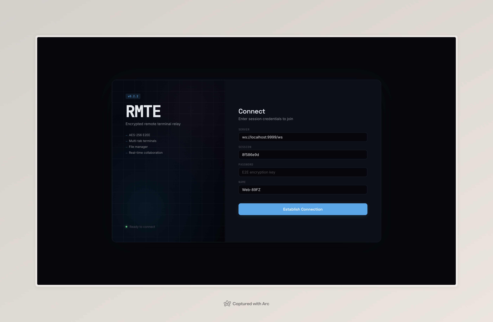
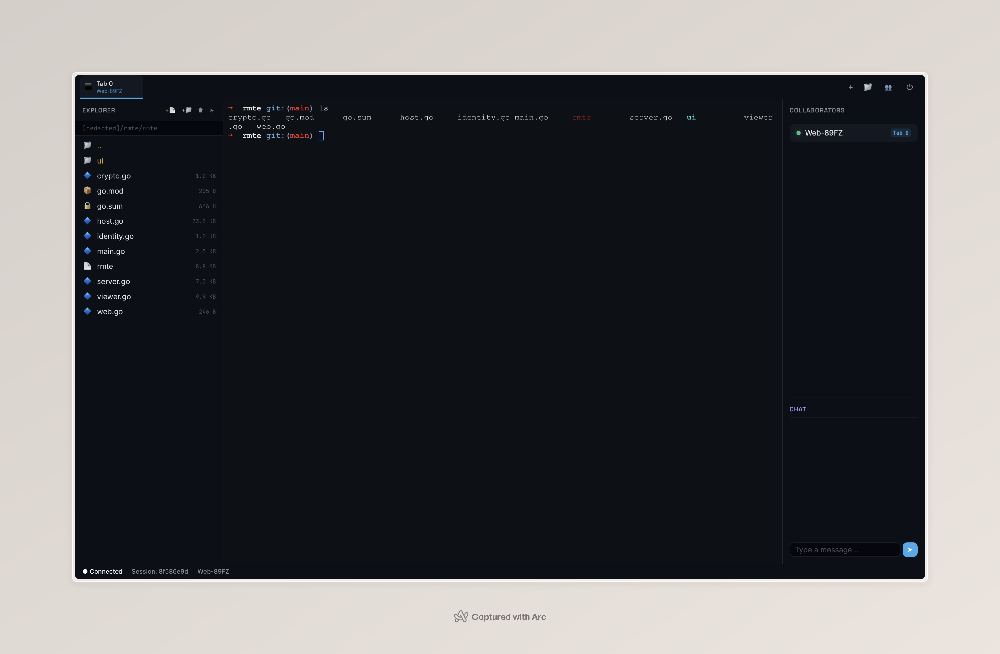

# RMTE — Remote Terminal Relay & Cloud IDE (v0.7.15)

> "I love sshx, but my endless curiosity to build it from scratch got the best of me 🥲"

RMTE is a secure, real-time, multi-user remote terminal sharing system and lightweight Cloud IDE. It is built entirely in Go with a centralized WebSocket relay architecture, securing all traffic with **AES-GCM 256-bit End-to-End Encryption (E2EE)**.

It allows hosts to share terminal sessions, navigate directories using a clean absolute-path File Explorer, edit files in real-time via a multi-tab Web UI, and inspect local web servers via an embedded Mini Browser—all packed into a single binary.

---

## Screenshots

### Login


### IDE Workspace


---

<details>
<summary><h3>✨ Key Features (click to expand)</h3></summary>

* **AI Agent Gateway & Model Context Protocol (MCP) (`🤖`):**
  * Direct zero-dependency **Model Context Protocol (MCP)** integration over stdio (`rmte mcp`) enabling local AI coding agents (Claude Desktop, Cursor, Claude Code, Antigravity) to work directly inside remote locked-down hosts/containers.
  * 7 powerful AI tools built-in: `rmte_exec` (synchronous execution in persistent isolated `[AI]` tab or dedicated background tabs), `rmte_read_file`, `rmte_write_file`, `rmte_upload_file`, `rmte_download_file`, `rmte_list_files`, `rmte_get_info`.
  * **Headless CLI Execution (`rmte exec`)**: Execute remote commands from local shell scripts and receive exact exit codes and clean stdout/stderr over E2EE.
  * **Read-Only Human Spectator Protection**: Live visual feedback of AI commands in the Web IDE without allowing human spectators to disrupt the AI's PTY.
* **Embedded Web Browser Preview (`🌐`):**
  * Built-in mini-browser directly inside the Web IDE tab bar, allowing developers to test local web apps (Vite, Next.js, React, Bun, Python, Dufs, Go, etc.) without leaving RMTE.
  * **Relay-Assisted Reverse Proxy**: Proxies any local port via path `/p/<session>/<port>/` over the single relay port with **zero external DNS dependency** (runs on plain raw IP).
  * **Anti-Lag Transport**: Uses an isolated secondary WebSocket (`{$ws-path}-proxy`) multiplexed with `smux v2` so high-bandwidth downloads never lag the PTY terminal.
  * **Full HMR & WebSocket Hijacking**: Automatically hijacks WebSocket upgrade requests for live Hot Module Reloading.
  * **Interactive Toolbar & Responsive 390px Mobile View**: Smart address bar, navigation controls (`[◀] [▶] [⟳]`), and mobile device inspection frame.
* **Windows Native ConPTY:**
  * Full pseudo-terminal support on Windows 10/11 using ConPTY: command history recall with arrow keys (`↑` / `↓`), horizontal cursor navigation (`←` / `→`), tab completion, and native ANSI color rendering.
* **Absolute Privacy (AES-GCM 256-bit):** Encryption keys and terminal/file I/O payloads are processed locally. The central relay server acts as a "dumb pipe" that only routes encrypted binary frames. It never sees your plaintext data, your files, or your password.
* **Single-Command Setup:** Run `rmte serve` to start a relay and host session in one process. A random password and a shareable link are printed automatically.
* **HTTP Compatible:** Works on plain HTTP (no HTTPS required). A built-in crypto polyfill (asmcrypto.js) handles AES-GCM when `crypto.subtle` is unavailable.
* **Shareable Links & Auto-fill UI:** Running a host session generates a web URL with pre-filled `?server=` and `?session=` parameters. The Web UI parses these and auto-focuses the password input for seamless onboarding.
* **Modern Web Redesign:** A sleek, split-viewport interface using OKLCH atmospheric themes, Space Grotesk/Inter/JetBrains Mono typography, and portable CSS design tokens (`tokens.css`).
* **Split-Workspace Cloud IDE:** Toggle the folder icon `📁` in the browser tab bar to open a split-view workspace:
  * **Left Panel**: Advanced File Explorer with resizable drag handle (persisted across reloads).
  * **Right Panel**: Tabbed text editor powered by **CodeMirror** (syntax highlighting, line numbers, unsaved indicators `●`, direct `Ctrl + S` saving).
  * **Bottom Panel**: Interactive, multi-tab terminal shells (`+ Terminal`).
* **Modern File Explorer & Manager:**
  * **Absolute PWD & Segment Breadcrumbs**: Displays the full host working directory with clickable path segments and a quick edit button (`✏️` or double-click) to type any path directly.
  * **Drag & Drop Upload & One-Click Download**: Drag files from your computer into the Explorer to upload; click the `⬇` icon to download host files locally.
  * **Parent Navigation (`..`)**: An always-visible `..` folder item allows walking backward up the host's directory structure.
  * **Inline Operations (Zero Browser Modals)**: Creating new files (`+📄`) or folders (`+📁`), renaming (`✏️`), and deleting (`🗑`) are performed via inline text inputs and non-intrusive confirmation strips (`[Yes] [No]`).
  * **Toast Notification HUD**: Directory and workspace errors are reported through transient, auto-dismissing inline Toasts.
* **Host Audit Event Log (`rmte-<session_id>.log`):**
  * Every session lifecycle event (host startup, client connects/disconnects, terminal tabs, and file reads/writes/creations/deletions) is securely logged to `rmte-<session_id>.log` on the host machine.
  * Real-time streaming to the UI with a live unread badge and instant `📥 Export` to download the log.
* **Unified Sidebar & Real-Time Chat Bridge:**
  * Dedicated multi-tab sidebar for `👥 Users` presence, `💬 Chat` (live encrypted bridge between Web and CLI clients), and `📜 Activity Log`.
* **Share Session Dialog (`🔗`):** Convenient modal to copy browser links or CLI join commands with one click.
* **Dynamic Max Buffer & Relay Adaptive Clamping:**
  * Set customizable memory limits via CLI (e.g. `--buffer=5` for 5MB limits) to configure both the terminal ring buffer and the maximum allowed file sizes.
  * **Relay Adaptive Clamping (`--max-buffer`)**: Self-hosted and public relays can set a maximum buffer threshold. If a connecting host requests more memory than allowed, the relay adaptively clamps the session without rejecting the host, and enforces transport-level WebSocket frame ceilings (`SetReadLimit`) to prevent DoS.
* **Relay Resource & DoS Protection:**
  * **Session Capacity (`--max-sessions`)**: Limits total concurrent active sessions (default: `100`, `0` = unlimited).
  * **Viewer Concurrency Ceiling (`--max-viewers`)**: Limits total active WebSocket connections per session across all viewer IDs and tabs (default: `50`, `0` = unlimited).
  * **Lean Smux Multiplexing**: Slices proxy stream buffers to 512 KB and session receive pools to 4 MB (~87.5% memory reduction).
* **Zero-copy Binary Data Channel (Tab ID `255`):** Avoids heavy Base64 parsing overhead. Files are sent as pure, encrypted binary frames over a reserved channel.
* **Background / Quiet Mode (`-q` / `--quiet` & `rmte stop`):**
  * Run `rmte serve` or `rmte share` as a detached background daemon. Prints the connection banner, shareable link, and PID to stdout, then immediately returns control to your shell.
  * Stop background sessions cleanly anytime using `rmte stop <session_id | pid>`.
* **State Persistence & Auto-Reconnect:** Connection credentials live safely in `sessionStorage` for immediate recovery upon page refresh.
* **Relay Admin Dashboard (`--admin-pass` & `--admin-path`):**
  * Built-in administrative web dashboard for self-hosted relays (`standalone`, `hybrid`, `relay`).
  * Live monitoring of active sessions, session capacity limits, connected viewers, and cumulative TX / RX network bandwidth.
  * Force-terminate sessions with one click and ban abusive IP addresses in real time.
  * Configurable dashboard route (default: `/admin`) protected against URI collision.

</details>

---

<details>
<summary><h3>🏗️ Architecture & Security Model (click to expand)</h3></summary>

```
┌───────────────┐                  ┌──────────────┐                  ┌───────────────┐
│               │  E2EE Control    │              │  E2EE Control    │               │
│               ├─────────────────►│              │◄─────────────────┤               │
│   Host Go     │                  │  Relay Go    │                  │  Viewer JS    │
│  Workspace    │  E2EE Tab 255    │  (WebSockets)│  E2EE Tab 255    │   Browser     │
│               │◄─────────────────┤              ├─────────────────►│               │
└───────────────┘  (Raw Binary)    └──────────────┘  (Raw Binary)    └───────────────┘
```

1. **E2EE Key Derivation**: A 256-bit key is derived locally from the shared password using SHA-256.
2. **AES-GCM Payload Envelope**: Control messages (JSON) and binary streams (terminal I/O & file operations) are encrypted using AES-GCM with a unique 12-byte initialization vector (IV) prepended to the ciphertext.
3. **Zero-Knowledge Relay**: The server only proxies binary envelopes and target routing IDs. It cannot read your commands, terminal outputs, or files.

</details>

---

## 📦 Installation

### 1-Line Quick Install & Launch
Run RMTE instantly without manual setup. The installer detects your OS and architecture automatically:

**Linux & macOS:**
```bash
# 1. Download to current directory (default)
curl -sSf https://rmte.biz.id/install.sh | sh

# 2. Run immediately without saving to current dir (uses /tmp)
curl -sSf https://rmte.biz.id/install.sh | sh -s run

# 3. Install system-wide (~/.local/bin or /usr/local/bin)
curl -sSf https://rmte.biz.id/install.sh | sh -s install

# 4. Download and run in one shot
curl -sSf https://rmte.biz.id/install.sh | sh -s download run

# 5. Run immediately in background daemon (quiet)
curl -sSf https://rmte.biz.id/install.sh | sh -s run -q
```

**Windows (PowerShell):**
```powershell
# 1. Download to current directory (default)
irm https://rmte.biz.id/install.ps1 | iex

# 2. Run immediately from temp folder
& ([scriptblock]::Create((irm https://rmte.biz.id/install.ps1))) run

# 3. Install to ~/.local/bin and add to User PATH
& ([scriptblock]::Create((irm https://rmte.biz.id/install.ps1))) install

# 4. Download and run in one shot
& ([scriptblock]::Create((irm https://rmte.biz.id/install.ps1))) download run

# 5. Run immediately in background daemon (quiet)
& ([scriptblock]::Create((irm https://rmte.biz.id/install.ps1))) run -q
```

### Pre-built Binaries
Get the latest pre-built releases for your operating system directly from the GitHub releases page:
👉 **[RMTE GitHub Releases](https://github.com/milio48/rmte/releases)**

### Build from Source
Got Go installed (v1.21+)? Let's build the binary:
```bash
git clone https://github.com/milio48/rmte.git
cd rmte/rmte
go build -ldflags "-s -w" -o rmte
```

<details>
<summary><h3>🛠️ Development & Testing Guide (click to expand)</h3></summary>

RMTE is designed with zero frontend dependencies. All web assets in `rmte/ui/` (`tokens.css`, `app.css`, `app.js`, `index.html`) are embedded directly into the Go binary at compile time via `//go:embed ui/*` without requiring Node.js, npm, or bundlers.

1. **Run locally without building:**
   ```bash
   cd rmte/rmte
   go run . serve --dir="../"
   ```
2. **Run Unit Tests:**
   ```bash
   cd rmte/rmte
   go test -v ./...
   ```
3. **Build Binary with Custom Version (`-ldflags`):**
   ```bash
   cd rmte/rmte
   go build -ldflags "-s -w -X main.appVersion=0.7.6" -o rmte
   ```

</details>

---

## 🧭 Terminology

| Term | Meaning | How |
| :--- | :--- | :--- |
| **Relay** | The machine that **opens a port** (HTTP Web UI + WebSocket routing) | `rmte serve` |
| **Host** | The **controlled machine** (shell + files) | `rmte serve` (standalone/hybrid) or `rmte share` |
| **Client** | Whoever controls the host: **Web** browser or **CLI/TUI** | Shareable link or `rmte join` |

## ⚖️ Commands & Modes

| | `serve --mode=standalone` *(default)* | `serve --mode=hybrid` | `serve --mode=relay` | `share` | `join` | `exec` | `mcp` |
| :--- | :---: | :---: | :---: | :---: | :---: | :---: | :---: |
| Opens a port | ✅ | ✅ | ✅ | ❌ | ❌ | ❌ | ❌ |
| Local shell/files (Host) | ✅ | ✅ | ❌ | ✅ | ❌ | ❌ | ❌ |
| Accepts external hosts (`share`) | ❌ | ✅ | ✅ | — | — | — | — |
| Prints Session ID + links | ✅ | ✅ | ❌ | ✅ | — | — | — |
| Uses `--pass` / `--buffer` / `--dir` / `--id` | ✅ | ✅ | ❌ | ✅ | `--pass` / `--id` | `--pass` / `--id` | `--pass` / `--id` |
| Role | Relay + Host | Relay + Host | Relay | Host | Client (TUI) | Client (Headless Exec) | Client (AI MCP Server) |

---

## 🚀 Quick Start Guide

### 0. Instant E2EE Share (Zero-Configuration)
Run `rmte` directly without subcommands to instantly connect to the public relay `my.rmte.biz.id` with Web Preview enabled:
```bash
./rmte
```
Or run detached in the background:
```bash
./rmte -q
```
Or with custom credentials:
```bash
./rmte --id="mysession" --pass="supersecret" -q
```

### 1. Quick local session (Self-hosted standalone)
```bash
./rmte serve
```
Output:
```
RMTE v0.7.15 — Mode: standalone
────────────────────────────────────────────────
Bind:             127.0.0.1:8048
Rmte Port:        8048
Open to Relay:    ❌ No
Directory:        /workspace
Custom Password:  ❌ No  (generated: YJNhJkzGHEhc)
Session ID:       16fd7ce2
Buffer limit:     1 MB
Web Path:         /
WS Path:          /ws-rmte

Shareable link (Web Version):
  http://localhost:8048/?server=ws%3A%2F%2Flocalhost%3A8048%2Fws-rmte&session=16fd7ce2

Join CLI / TUI Version:
  rmte join --server-relay="ws://localhost:8048/ws-rmte" --id="16fd7ce2" --pass="YJNhJkzGHEhc"
```

### Case 1: Single VPS (self-contained)
One machine is both the relay and the host. External hosts are rejected.
```bash
./rmte serve --public --public-url="https://rmte.example.com" --pass="supersecret123"
```
```
┌────────────────────────────────────────────────────────┐
│ VPS_1: RELAY + HOST (rmte serve --public)              │
│ ✓ HTTP port 8048 (Web UI)                              │
│ ✓ WebSocket /ws-rmte (routing)                         │
│ ✓ Local shell & files                                  │
│ ✗ External hosts rejected (standalone)                 │
└───────────────────────────┬────────────────────────────┘
              ┌─────────────┼──────────────┐
           ┌──▼──┐       ┌──▼──┐       ┌───▼────┐
           │ CLI │       │ WEB │       │ WEB    │
           └─────┘       └─────┘       └────────┘
            join         browser        browser
```

### Case 2: Multi-VPS (central relay + separate hosts)
Only the relay opens a port. Hosts connect **outbound**, so they need no open ports.
```bash
# VPS_1 (relay only)
./rmte serve --mode=relay --public --public-url="https://relay.example.com"

# VPS_2, VPS_3, VPS_4 (each becomes a host with its own Session ID)
./rmte share --server-relay="ws://relay.example.com:8048/ws-rmte" --pass="supersecret123" --buffer=5
```
```
┌───────────────┐   ┌───────────────┐   ┌───────────────┐
│ VPS_2: HOST   │   │ VPS_3: HOST   │   │ VPS_4: HOST   │
│ (rmte share)  │   │ (rmte share)  │   │ (rmte share)  │
│ ✗ no open port│   │ ✗ no open port│   │ ✗ no open port│
└───────┬───────┘   └───────┬───────┘   └───────┬───────┘
        │ outbound WS       │                   │
        └───────────────────┼───────────────────┘
                            ▼
┌────────────────────────────────────────────────────────┐
│ VPS_1: RELAY (rmte serve --mode=relay --public)        │
│ ✓ HTTP port 8048 (Web UI)                              │
│ ✓ WebSocket /ws-rmte (routing)                         │
└───────────────────────────┬────────────────────────────┘
              ┌─────────────┼──────────────┐
           ┌──▼──┐       ┌──▼──┐       ┌───▼────┐
           │ CLI │       │ WEB │       │ WEB    │
           └─────┘       └─────┘       └────────┘
            join         browser        browser
```
> Want the relay machine to also be a host? Use `--mode=hybrid` instead of `--mode=relay`.

### Join via CLI Client (TUI)
```bash
./rmte join --server-relay="ws://relay.example.com:8048/ws-rmte" --id="a1b2c3d4" --pass="supersecret123"
```
You'll enter an interactive TUI menu:
* `[j]` **Join Tab:** Dive into the active terminal shell (Press `Ctrl + ]` to escape).
* `[n]` **New Tab:** Spawn a concurrent shell on the host.
* `[s]` **Switch Tab:** Hop between active terminal tabs.
* `[c]` **Chat:** Enter the real-time chat room.
* `[q]` **Quit:** Disconnect gracefully.

### Join via Web Client
Open the shareable link printed by `serve`/`share` (or browse to the relay's web path — the server URL is auto-filled).
1. Enter the E2EE **Password** and click **Establish Connection**.
2. Toggle the folder icon `📁` in the tab bar to access the workspace editor.
3. Double-click the breadcrumb to input any absolute path directly.

### 🤖 AI Agent Integration (MCP & Headless CLI Exec)
You can connect local AI coding agents (Claude Desktop, Cursor, Claude Code, Antigravity) to execute commands, read/write files, and transfer data inside remote host environments over secure E2EE with zero open inbound ports!

#### 1. Enable on Remote Host:
Start the host session with `--allow-exec`:
```bash
./rmte share --allow-exec
# or for self-hosted standalone:
./rmte serve --allow-exec
```

#### 2. Headless CLI Execution (`rmte exec`):
Run remote commands from local shell scripts and propagate exit codes:
```bash
./rmte exec --id="session_id" --pass="secret" -- "uname -a"

# Launch long-running commands in a dedicated background tab:
./rmte exec --id="session_id" --pass="secret" --bg --tab-name="DevServer" -- "npm run dev"
```

#### 3. Model Context Protocol (MCP) Setup:
Configure your local AI coding assistant to communicate with RMTE via stdio:

**Claude Desktop Configuration (`claude_desktop_config.json`):**
```json
{
  "mcpServers": {
    "rmte": {
      "command": "rmte",
      "args": [
        "mcp",
        "--server-relay=wss://my.rmte.biz.id/ws-rmte",
        "--id=<session_id>",
        "--pass=<password>"
      ]
    }
  }
}
```

**Cursor MCP Configuration:**
Add a new stdio MCP server:
- Name: `rmte`
- Command: `rmte mcp --server-relay=wss://my.rmte.biz.id/ws-rmte --id=<session_id> --pass=<password>`

**Available MCP Tools:**
* `rmte_exec`: Run shell commands in the persistent `[AI]` tab or in dedicated background tabs.
* `rmte_read_file`: Read UTF-8 text from remote host files.
* `rmte_write_file`: Write or overwrite text files on the remote host.
* `rmte_upload_file`: Upload local files from your machine to the remote host.
* `rmte_download_file`: Download remote files to your local machine.
* `rmte_list_files`: List directory contents on the remote host.
* `rmte_get_info`: Inspect remote host environment metadata (OS, architecture, hostname, working directory, PID, active tabs).

> 📖 **Complete Documentation & Config Generator:** For a deep dive into security sandboxing, persistent vs background AI tabs, and interactive configuration generation for Claude Desktop and Cursor, see the **[RMTE AI & MCP Guide](https://rmte.biz.id/mcp.html)** (or [`docs/mcp.html`](docs/mcp.html)).

### 🛡️ Relay Admin Dashboard
Self-hosting your own relay server (`standalone`, `hybrid`, or `relay`)? You can enable the real-time web administration dashboard by specifying `--admin-pass`:
```bash
# Start a relay server with Admin Dashboard enabled
./rmte serve --mode=relay --public --admin-pass="supersecret123" --admin-path="/admin" -q
```
Then navigate to `http://your-relay:8048/admin` in your browser and enter the password:
* **Live Overview:** Real-time statistics including active sessions, connected viewers, and cumulative TX / RX bandwidth.
* **Session Management:** Inspect active host session IDs and view connected viewer counts.
* **Instant Termination:** Force-close suspicious or hung sessions immediately with one click (`/admin/api/terminate`).
* **IP Banning:** Permanently ban malicious remote IP addresses in real time (`/admin/api/ban`).
* **Custom Route:** Customize the path via `--admin-path` (e.g. `--admin-path="/control"`). It cannot collide with `/p` (Web Preview), `/favicon.ico`, or the Web UI.

---

## 📖 Flag Reference

### `rmte` (Zero-Config Instant Share)
Run `rmte` without subcommands to share directly to `my.rmte.biz.id`:
| Flag | Default | Description |
| :--- | :--- | :--- |
| `--pass`, `--password` | *random* | E2EE password (printed if generated) |
| `--pass-file` | `""` | Read password from local file (`0600` permissions on Unix) |
| `--id` | *random* | Custom persistent Session ID (`a-z`, `0-9`, max 10 chars) |
| `--dir` | `""` | Initial working directory for File Explorer and terminal |
| `--sandbox`, `--dir-only` | `false` | Confine Web Explorer and file tools to workspace directory (files only; does not jail shell) |
| `--buffer` | `1` | Terminal ring buffer & max file size (MB) |
| `--web-preview` | `true` | Embedded Web Browser Preview reverse proxy (`--preview` alias) |
| `--allow-exec` | `false` | Allow remote command execution via MCP or CLI exec (`--enable-ai` alias) |
| `-q`, `--quiet` | `false` | Run in background (detached) and print connection info with PID |
| `--server-relay`, `--server` | `wss://my.rmte.biz.id/ws-rmte` | Relay WebSocket URL |
| `--insecure`, `--skip-tls-verify` | `false` | Skip TLS certificate verification (process-wide, for self-signed relays; also disables TLS checks on update downloads) |

### `rmte share`
Connect a host to a relay server (defaults to public relay):
| Flag | Default | Description |
| :--- | :--- | :--- |
| `--server-relay`, `--server` | `wss://my.rmte.biz.id/ws-rmte` | Relay WebSocket URL |
| `--pass`, `--password` | *random* | E2EE password (printed if generated) |
| `--pass-file` | `""` | Read password from local file (`0600` permissions on Unix) |
| `--id` | *random* | Custom persistent Session ID (`a-z`, `0-9`, max 10 chars) |
| `--dir` | `""` | Initial working directory for File Explorer and terminal |
| `--sandbox`, `--dir-only` | `false` | Confine Web Explorer and file tools to workspace directory (files only; does not jail shell) |
| `--buffer` | `1` | Terminal ring buffer & max file size (MB) |
| `--web-preview` | `true` | Embedded Web Browser Preview reverse proxy (`--preview` alias) |
| `--allow-exec` | `false` | Allow remote command execution via MCP or CLI exec (`--enable-ai` alias) |
| `-q`, `--quiet` | `false` | Run in background (detached) and print connection info with PID |
| `--insecure`, `--skip-tls-verify` | `false` | Skip TLS certificate verification (process-wide, for self-signed relays; also disables TLS checks on update downloads) |

### `rmte serve`
| Flag | Default | Description |
| :--- | :--- | :--- |
| `--mode` | `standalone` | `standalone` \| `hybrid` \| `relay` |
| `--port` | `8048` | Listen port |
| `--pass` | *random* | E2EE password (printed if generated). Ignored in `relay` |
| `--pass-file` | `""` | Read password from local file (`0600` permissions on Unix). Ignored in `relay` |
| `--id` | *random* | Custom persistent Session ID (`a-z`, `0-9`, max 10 chars). Ignored in `relay` |
| `--dir` | `""` | Initial working directory for File Explorer and terminal |
| `--sandbox`, `--dir-only` | `false` | Confine Web Explorer and file tools to workspace directory (files only; does not jail shell). Ignored in `relay` |
| `--buffer` | `1` | Terminal ring buffer & max file size (MB). Ignored in `relay` |
| `--web-path` | `/` | Path of the Web UI (e.g. `/web`) |
| `--ws-path` | `/ws-rmte` | WebSocket path |
| `--public-url`, `--url` | `""` | Public base URL or domain advertised in links (e.g. `https://my.rmte.biz.id` or `http://host:8041`) |
| `--public` | `false` | Bind `0.0.0.0` instead of `127.0.0.1` |
| `--no-web` | `false` | Don't serve the Web UI |
| `--no-cli` | `false` | Reject CLI clients (soft restriction: clients self-declare) |
| `--web-preview` | `false` | Enable Embedded Web Browser Preview reverse proxy (`--preview` alias) |
| `--allow-exec` | `false` | Allow remote command execution via MCP or CLI exec (`--enable-ai` alias) |
| `-q`, `--quiet` | `false` | Run in background (detached) and print connection info with PID |
| `--admin-path`, `--path-admin` | `/admin` | HTTP path for Relay Admin Dashboard |
| `--admin-pass`, `--password-admin` | `""` | Password for Relay Admin Dashboard (disabled if empty) |
| `--max-buffer` | `0` | Max buffer limit in MB per session (`0` = unlimited / opt-in; enforces `SetReadLimit`, recommended for multi-tenant relays) |
| `--max-sessions` | `100` | Max concurrent active sessions on relay (`0` = unlimited) |
| `--max-viewers` | `50` | Max viewer connections per session (`0` = unlimited) |
| `--insecure`, `--skip-tls-verify` | `false` | Skip TLS certificate verification (process-wide) |

### `rmte join`
| Flag | Default | Description |
| :--- | :--- | :--- |
| `--server-relay` | `wss://my.rmte.biz.id/ws-rmte` | Relay WebSocket URL (defaults to public relay) |
| `--id` | *required* | Session ID |
| `--pass` | *required* | E2EE password |
| `--pass-file` | `""` | Read password from local file |
| `--name` | *prompt* | Display name |
| `--insecure`, `--skip-tls-verify` | `false` | Skip TLS certificate verification (process-wide, for self-signed relays) |

### `rmte exec`
| Flag | Default | Description |
| :--- | :--- | :--- |
| `--server-relay` | `wss://my.rmte.biz.id/ws-rmte` | Relay WebSocket URL (defaults to public relay) |
| `--id` | *required* | Session ID |
| `--pass` | *required* | E2EE password |
| `--pass-file` | `""` | Read password from local file |
| `--timeout` | `60` | Execution timeout in seconds |
| `--bg`, `--background` | `false` | Run command in a dedicated background tab |
| `--tab-name`, `--name-tab` | `""` | Custom tab title when running in background |
| `--name` | `rmte-exec` | Client display name |
| `--insecure` | `false` | Skip TLS certificate verification |

### `rmte mcp`
| Flag | Default | Description |
| :--- | :--- | :--- |
| `--server-relay` | `wss://my.rmte.biz.id/ws-rmte` | Relay WebSocket URL (defaults to public relay) |
| `--id` | *required* | Session ID |
| `--pass` | *required* | E2EE password |
| `--pass-file` | `""` | Read password from local file |
| `--name` | `Claude-MCP` | Client display name |
| `--insecure` | `false` | Skip TLS certificate verification |

### `rmte stop`
Stop a background session running in quiet mode (`-q`):
```bash
# Stop using Session ID:
rmte stop <session_id>

# Or stop using PID:
rmte stop <pid>
```

### `rmte update` (or `rmte upgrade`)
Update the `rmte` binary in-place directly from official GitHub releases:
```bash
# Check if a new version is available without downloading
rmte update --check

# Download and replace the current binary (verifies SHA-256 checksums.txt)
rmte update

# Force download even if already on the latest version
rmte update --force

# Update binary and seamlessly restart active background session
rmte update --restart

# Force update bypassing checksum verification (fail-closed override)
rmte update --skip-checksum-verify
```
> **Seamless Viewer Reconnect:** When restarting sessions using `--restart` (or reusing the same `--id`), connected browser tabs will automatically reconnect through their exponential-backoff retry loop without re-entering credentials.

---

## 🔐 Security & Environment Variables

### Credential Precedence
RMTE resolves credentials according to strict precedence across all subcommands (`share`, `serve`, `join`, `exec`, `mcp`):
1. **CLI Flag (`--pass`)**: Overrides all other sources. *(Exposed in `ps aux`)*
2. **Password File (`--pass-file <path>`)**: Reads from disk. *(Checks for `0600` permissions on Unix; recommended for automated services)*
3. **Environment Variable (`RMTE_PASS`)**: Ingested from process environment. *(Host prints anti-footgun warning banner if active to prevent unintentional re-use)*
4. **Default**: Host generates a cryptographically secure 12-character random password.

### Supported Environment Variables
| Variable | Subcommands | Description |
| :--- | :--- | :--- |
| `RMTE_PASS` | `share`, `serve`, `join`, `exec`, `mcp` | Session E2EE password |
| `RMTE_SERVER` | `share`, `join`, `exec`, `mcp` | Default relay WebSocket URL (`--server-relay`) |
| `RMTE_ID` | `share`, `serve`, `join`, `exec`, `mcp` | Pre-set Session ID (`--id`) |
| `RMTE_ADMIN_PASS` | `serve` | Relay Admin Dashboard password (`--admin-pass`) |

> 📖 **Security Model & Reporting:** For details on our end-to-end encryption model, filesystem sandbox boundaries (`--sandbox` files $\neq$ shell container), and responsible vulnerability disclosure, please read our [SECURITY.md](SECURITY.md).

---

<details>
<summary><h3>🔄 Migrating from v0.3.x (click to expand)</h3></summary>

| v0.3.x | v0.4.0 |
| :--- | :--- |
| `rmte serve --port=8080` (relay) | `rmte serve --mode=relay --public` |
| `rmte serve --pass="x"` | `rmte serve --pass="x" --public` (standalone) |
| `--server="ws://host:8080/ws"` | `--server-relay="ws://host:8048/ws-rmte"` |
| Binds all interfaces | Binds `127.0.0.1` unless `--public` |
| Protocol `0.3` | Protocol `0.4` — run the same version on relay, hosts and clients |

</details>
